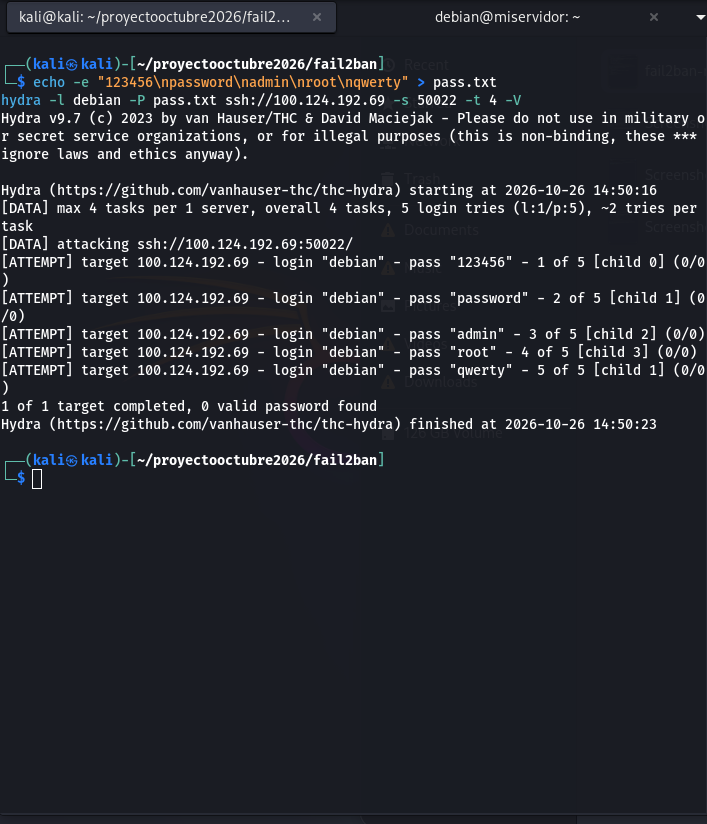
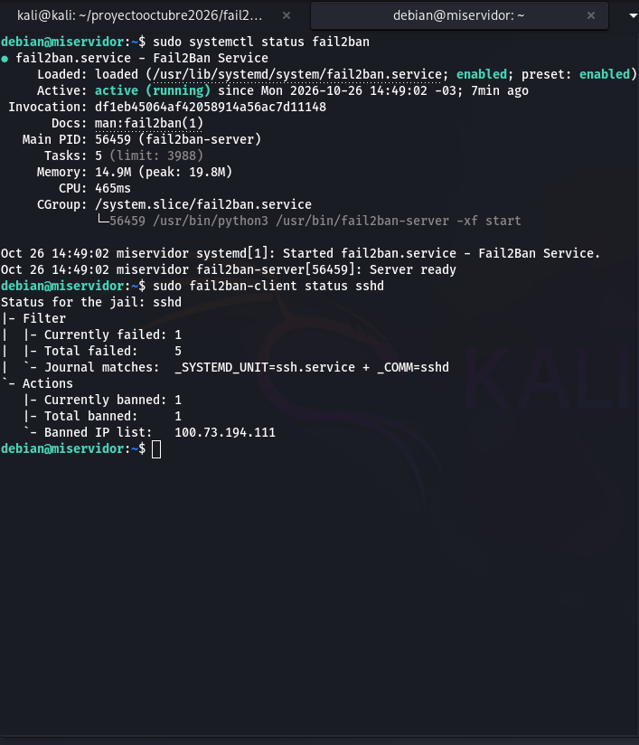

# Fail2ban Lab: SSH Brute-Force Detection & Mitigation 

## Objective
To simulate a real-world SSH brute-force attack and configure Fail2ban to 
automatically detect and block the offending IP address, demonstrating Blue Team 
defensive capabilities.

## Environment
- **Attacker:** Kali Linux (Tailscale IP: `100.73.194.111`).
- **Defender:** Debian Server (SSH on custom port `50022`).
- **Defense Tool:** Fail2ban (Intrusion Prevention System).

## The Attack (Attacker's Perspective)
Using `hydra` on Kali Linux, I launched a dictionary attack against the Debian 
server targeting the custom SSH port. I used a small wordlist to simulate the 
initial phase of a brute-force attack. 
- **Result:** 5 failed login attempts.

### Evidence: Hydra Attack in Progress

*The screenshot shows Hydra attempting various passwords ("123456", "password", 
"admin", etc.) and failing.*

## The Defense (Defender's Perspective)
Fail2ban was configured in `/etc/fail2ban/jail.local` to monitor the SSH logs. 
The policy was set to ban any IP for 10 minutes (`bantime = 600`) after 3 failed 
attempts (`maxretry = 3`).

### Evidence: Fail2ban Mitigation

*The screenshot shows Fail2ban successfully detecting the attack and adding the 
Kali IP (`100.73.194.111`) to the banned list.*

## Key Takeaways
- **Detection is Reactive but Effective:** Fail2ban successfully blocked the 
attack after the 3rd failed attempt.
- **Custom Ports Work:** Monitored traffic on a non-standard port (`50022`), proving 
that moving away from port 22 doesn't stop attackers but does filter automated noise.
- **Log Monitoring:** Relied on the systemd journal for real-time log analysis of SSH 
authentication failures.
